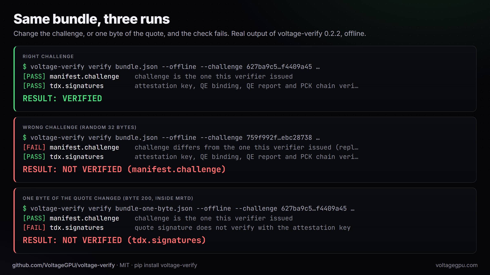

# voltage-verify

[](https://pypi.org/project/voltage-verify/) [](https://github.com/VoltageGPU/voltage-verify/actions) [](LICENSE) [](https://github.com/VoltageGPU/confidential-gpu-attestation-evidence)

Bind an Intel TDX quote and an NVIDIA GPU attestation to the workload you meant to run, then
verify the bundle on your own machine, without trusting the cloud provider.

`voltage-verify` is a small command line tool with three roles:

1. **On your machine**, it writes a *manifest*: the container image digest, the digests of the
   model or files you care about, a free-text statement, and a fresh random challenge. Two
   hashes of that manifest become the *commitments*.
2. **Inside the confidential VM**, it asks the hardware to sign those commitments: the Intel
   TDX quote carries `SHA-512(manifest)` as its 64-byte `report_data`, and NVIDIA's Remote
   Attestation Service (NRAS) signs GPU claims over the nonce `SHA-256(manifest)`. It writes
   one JSON *bundle* with the quote, the NVIDIA tokens and the public collateral needed to
   check them later.
3. **Back on your machine**, it verifies the bundle: Intel's signature chain to the pinned
   Intel SGX Root CA, that the Trust Domain does not run in debug mode, the platform's TCB
   status against Intel's published TCB info, the Quoting Enclave identity, revocation lists,
   NVIDIA's ES384 signatures against the NRAS JWKS carried by the bundle (each key trusted
   only through its x5c chain to a pinned NVIDIA NRAS intermediate, 004 or 005, listed once, so a bundle
   cannot bring its own signing key), the per-GPU claims (measurements ok, secure boot on,
   debug off), that every GPU token is one NVIDIA's verifier token lists, and above all that
   both proofs carry *your* commitments. Then it runs ten negative tests to show that any
   change to the manifest, the challenge, the quote or a GPU claim is rejected, and so are
   tokens re-signed with a key of the attacker's choosing, a GPU token added to pad the count,
   and a JWKS that lists the signing key twice or drops its certificate chain.

It was written by [VoltageGPU](https://voltagegpu.com) so that tenants of its Confidential VMs
can verify more than "this is a TDX VM with a confidential GPU": they can verify that the two
hardware proofs were produced *for the workload described in a manifest they wrote*, on a
challenge they chose. The trust chain ends at Intel and NVIDIA, never at VoltageGPU.

## Try it in five minutes, no account

Verify a real bundle, captured by us inside a rented Intel TDX VM with an RTX PRO 6000 Blackwell on
17 September 2026, on your own machine. The challenge is the one written in the manifest of that run.

```bash
pip install "voltage-verify>=0.3.0"
curl -sLO https://raw.githubusercontent.com/VoltageGPU/confidential-gpu-attestation-evidence/main/rtx6000b-2026-09-17/bundle.json
curl -sLO https://raw.githubusercontent.com/VoltageGPU/confidential-gpu-attestation-evidence/main/rtx6000b-2026-09-17/manifest.json
voltage-verify verify bundle.json \
  --challenge "$(python3 -c "import json; print(json.load(open('manifest.json'))['challenge'])")" \
  --hwmodel GB20X --gpus 1
```

Expected last line: `RESULT: VERIFIED`, with the platform judged on Intel's collateral of today.
Change one character of the challenge and run it again: the result flips to `NOT VERIFIED`.
With `--offline` the tool uses the Intel collateral carried by the bundle instead: it must then
be at most 30 days old (this one is older: `--max-collateral-age` accepts it explicitly), and the
verdict says the TCB was not checked against Intel today, with exit code 3. More bundles, with
their dates and limits, in
[confidential-gpu-attestation-evidence](https://github.com/VoltageGPU/confidential-gpu-attestation-evidence);
the field-by-field reading of the quote is in
[this tutorial](https://voltagegpu.com/blog/read-intel-tdx-quote-field-by-field).



## What it proves, and what it does not

Verified means:

* the TDX quote was produced inside a genuine Intel TDX Trust Domain that does not run in
  debug mode (the host can read and modify the memory of a debug TD), on a platform whose
  provisioning certificate chains to Intel's root, at an acceptable TCB level, by a genuine
  Quoting Enclave, and it embeds `SHA-512` of your manifest;
* NVIDIA's service signed, over `SHA-256` of your manifest, that the GPU(s) whose evidence
  answered that nonce passed attestation with secure boot on and debugging off;
* both proofs were made after you issued the challenge, so they cannot be replayed from an
  earlier session or copied from another tenant (with `--challenge`; without it,
  `manifest.challenge` warns that freshness and replay are not checked).

Verified does **not** mean:

* that the GPU *executed* the image or model named in the manifest. Binding a manifest to a
  quote proves the hardware signed your description of the workload; proving that this exact
  code ran needs a measured launcher (for instance the Confidential Containers project with
  a key broker), which is outside this tool;
* anything about the VM's own software stack unless you pin its TDX measurements: pass
  `--expect-mrtd` (and `--expect-rtmr0` to `--expect-rtmr3`) with the values of the image you
  trust. Without them the result still reads `VERIFIED`, and `tdx.measurements` warns
  `TD software not pinned: pass --expect-mrtd to check it`;
* that the attested GPUs are attached to this VM: NVIDIA's tokens name no TD, and the quote and
  the tokens meet only in the manifest they both commit to;
* anything about a VM you did not attest yourself.

`docs/WHAT_IT_PROVES.md` goes through every check and its limit.

## Install

```
# verifier machine: Python 3.10+, cryptography, PyJWT
pip install voltage-verify
# inside the VM: the NVIDIA SDK first (it pins cryptography and PyJWT), then the tool
pip install nv-attestation-sdk nvidia-ml-py
pip install --no-deps voltage-verify
```

Source and issues: https://github.com/VoltageGPU/voltage-verify. The same wheel and source
archive are mirrored with SHA-256 sums at https://voltagegpu.com/blog/two-proofs/voltage-verify/
for installs that must not touch PyPI (`pip install <wheel URL>`).

## Reference run

`examples/hello-workload/` holds a real bundle captured on 12 September 2026 on a VoltageGPU
`h100-xlarge` Confidential VM (8x H100, NVIDIA Protected PCIe mode), with its manifest and the
unedited run log. Replay the verification on your own machine:

```
voltage-verify verify examples/hello-workload/bundle-8xh100-2026-09-12.json \
    --challenge ef7f54c160627ee536a02b5e73896ac4b1ac2cdefdb7cfaaf2366a7d33cc8731 --hwmodel GH100 --gpus 8
voltage-verify selftest examples/hello-workload/bundle-8xh100-2026-09-12.json
```

Expected: every required check `PASS` (the `WARN` lines name what is not verified: the TD
software you did not pin, the NVSwitch fabric), platform TCB `UpToDate`, Quoting Enclave
`UpToDate`, eight `GH100` devices with `measres success`, then ten mutations rejected. Read
those tokens for what they are: in Protected PCIe mode `nvidia-smi` reports `CC State: OFF`
next to `Multi-GPU Mode: Protected PCIe` (the normal reading for that mode, kept in the
bundle's `environment` section), NVIDIA attested each of the eight GPUs individually, the
NVSwitch fabric is not attested, and this is not the single-GPU `CC State: ON` mode of an H200
VM. `docs/WHAT_IT_PROVES.md` spells out the difference.

## Use

On your machine, describe the workload and generate a challenge:

```
voltage-verify manifest --image ghcr.io/you/app:1.4.2 --artifact model.safetensors \
    --statement "inference run for customer X" -o manifest.json
```

Copy `manifest.json` into the VM (scp), then, as root inside the VM:

```
sudo -E python -m voltage_verify attest --manifest manifest.json -o bundle.json
```

Copy `bundle.json` back, then:

```
voltage-verify verify bundle.json --challenge <the challenge printed by `manifest`>
voltage-verify selftest bundle.json --challenge <same>
voltage-verify verify bundle.json --offline      # Intel collateral from the bundle, at most 30 days old
```

Exit code 0 means verified, 1 means a required check failed, 2 means the bundle or arguments
are unusable (an unusable bundle is reported as the failed check `bundle.malformed`, also in
`--json`), 3 means verified with a limit the verdict names: offline, the TCB was not checked
against Intel's collateral of today (`--accept-offline-tcb` accepts that, exit code 0); with
`--health`, the health report has warnings or untested parts ([below](#hardware-health-check-health)).
`--json` prints the machine-readable report, with the same `verdict` and its `limits`.

## Works with any Intel TDX host, any provider

Nothing here is VoltageGPU-specific, and the tool does not call VoltageGPU's API to attest or
to verify. `manifest` and `verify` run entirely on your own machine. `attest` reads the kernel's
own confidential-computing interface, `/sys/kernel/config/tsm/report` (configfs TSM, upstream
since Linux 6.7, present on any distribution with a recent kernel), and calls NVIDIA's own SDK,
`nv-attestation-sdk`, to talk to NVIDIA's Remote Attestation Service. Neither of those is a
VoltageGPU endpoint. So `attest` runs the same way inside a TDX guest on Azure, on GCP, on a bare
metal TDX host with a passthrough NVIDIA GPU, or on VoltageGPU: the interface is the Linux kernel
and NVIDIA's own service, not us. `verify` checks the bundle against Intel's and NVIDIA's public
collateral, also fetched from Intel and NVIDIA, never from VoltageGPU.

What this means in practice: if your workload runs on a TDX VM with an NVIDIA H100, H200, or
Blackwell GPU in confidential compute mode, anywhere, `voltage-verify attest` inside that VM and
`voltage-verify verify` on your laptop give you the same tenant-side proof this tool was built to
give VoltageGPU's own customers. We have not run this against every cloud ourselves (the
[reference run](#reference-run) above is on our own fleet, because that is the hardware we have),
so if you verify a bundle produced elsewhere, an issue or a pull request with what you saw, good
or bad, is exactly the kind of report `SECURITY.md` and this repository want.

## Verify a quote from anywhere

`quote` takes a bare Intel TDX quote, from any provider, any tool, and runs the Intel half of
the checks on it: structure, the TD's debug bit, signature chain up to the pinned Intel root,
then TCB status, QE identity and revocation from Intel PCS. No manifest, no NVIDIA token, no
VoltageGPU anywhere in the path. The file can be the raw bytes written by
`/sys/kernel/config/tsm/report`, or hex, or base64.

```
voltage-verify quote quote.bin
voltage-verify quote quote.bin --report-data <64 bytes hex>   # bind it to the nonce you issued
voltage-verify quote quote.bin --offline                       # signatures only, TCB not checked: exit code 3
voltage-verify quote quote.bin --accept-out-of-date --json
voltage-verify quote quote.bin --allow-debug                   # a debug TD as a warning, development only
```

Tested on Google's production Sapphire Rapids quote from
[go-tdx-guest](https://github.com/google/go-tdx-guest/blob/main/testing/testdata/tdx_prod_quote_SPR_E4.dat)
(vendored in `tests/fixtures/third-party/`, Apache 2.0). Output with `--accept-out-of-date` on
21 October 2026 (0.2.2):

```
[PASS] tdx.structure   TDX quote v4, TEE 0x81, 4935 bytes
[WARN] tdx.trailing    39 bytes after the signature data were ignored (not covered by any signature)
[PASS] tdx.debug       TD attributes 0000004000000000 (0x40000000), DEBUG (bit 0) off: not a debug TD
[PASS] tdx.signatures  attestation key, QE binding, QE report and PCK chain verify up to the pinned Intel SGX Root CA
[PASS] tdx.collateral  TCB info and QE identity signed by Intel (Intel PCS, fetched now)
[WARN] tdx.tcb         no TCB level in Intel's TCB info matches this platform (treat as OutOfDate)
```

Two things to read in that output. The trailing bytes are a marker Google appends on purpose
in its test vector; they sit outside the signed region and are reported, not silently dropped.
The TCB warning is real: that 2023 quote comes from a platform whose firmware level Intel no
longer lists, so a verifier must call it OutOfDate. Without `--accept-out-of-date` the exit
code is 1, which is the right answer for a quote you would rely on today.

`tdx.debug` reads bit 0 of the TD attributes in the TD report. A TD in debug mode gives no
confidentiality: the host can read and modify its memory and CPU state, yet Intel's Quoting
Enclave signs its quote like any other, so the signature chain alone does not catch it. `quote`
and `verify` fail on that bit; `--allow-debug` (both commands) turns the failure into a visible
warning, for development VMs only. Versions up to 0.2.1 reported the TD attributes in the
`--json` facts without checking them.

## Hardware health check (`health`)

Unreleased, planned for 0.4.0. `health` checks the NVIDIA GPUs of the machine it runs on, the
way a stability test does on a desktop, for server GPUs under Linux: what is there, what the
error counters say, how the sensors behave under a load that changes, whether the GPU computes
right and whether its memory holds what is written to it. It runs on any Linux machine with an
NVIDIA GPU and the NVIDIA driver, not only in a TDX VM, as an ordinary user. It is local and
read-only: no root, no network, nothing about the machine is sent anywhere, nothing is
installed. The only file it writes is the `-o` report, readable by its owner only, since it
names the machine; PyTorch and the CUDA runtime may fill their own caches under the home
directory. It does not need root, and reads everything but the kernel log without it. Run as
root (to have `errors.xid`), it starts `nvidia-smi`, `dmesg` and the Python it runs under
from `PATH` and `PYTHONPATH` as they are, like any command run as root: do not use `sudo -E`
from an account whose environment you do not trust. Run it on a machine that does nothing else: for the length of the run the load
takes every GPU, and the VRAM test takes their free memory, so a job running next to it would
slow down or run out of memory.

```
voltage-verify health --quick                      # 60 seconds of load
voltage-verify health --expect-gpu "H100" --expect-gpus 8 --expect-vram 80 -o health.json
```

| Check | How | Verdict |
|---|---|---|
| `inventory.gpus` | `nvidia-smi --query-gpu`: model, count, VRAM, driver, vbios, PCI bus and device id | FAIL if no GPU is visible; WARN on mixed models or MIG enabled |
| `inventory.model`, `inventory.count`, `inventory.vram` | only with `--expect-gpu`, `--expect-gpus`, `--expect-vram`: what the listing says against what the driver reports | FAIL if a token of the listed name that carries a digit (`4090`, `h100`, `80gb`) is missing from the reported name, if fewer GPUs are visible, or if the smallest GPU has under 93% of the listed VRAM (the driver reports less than the round figure of a spec sheet) |
| `errors.ecc` | ECC counters, retired pages and remapped rows, read before and after the load | FAIL on an uncorrected error since the driver loaded, a pending page retirement or row remap (the GPU needs a reset), a failed remap; WARN on ECC disabled, corrected errors during the test, lifetime uncorrected errors, retired or remapped memory; INFO when the GPU has no ECC (consumer cards) |
| `errors.xid` | `dmesg`, else `journalctl -k`; never `sudo` | FAIL on a hardware Xid during the test (48, 62, 64, 74, 79, 92, 94, 95, 119, 120, 140 in NVIDIA's Xid catalog); WARN on another Xid during the test, or a hardware Xid earlier in this boot; SKIP when the kernel log is not readable without root |
| `sensors.thermal` | temperature, power draw, power limit and slowdown reasons, read every 2 s during the load (every 5 s past two minutes) | FAIL if hardware thermal slowdown or power brake is active in 5% of the samples or more on a GPU; WARN on any thermal or hardware slowdown, a power limit set under the GPU's default, or a GPU 10 C hotter than the median GPU. Reaching the power cap under full load is normal and not a warning |
| `sensors.clocks` | the same samples: SM clock, utilisation | WARN if a GPU's median SM clock under load is under 85% of the median GPU, or a GPU never reached 90% utilisation |
| `compute.matmul` | on every GPU at once, the same half-precision 8192x8192 matrix product again and again, each result compared with the first one; before it, a product of integer-valued float64 matrices compared with the CPU's (exact in any order of operations). The load is variable: bursts of 8, 4, 2 and 1 seconds with pauses in between, for the power and thermal transients a constant load never causes | FAIL if a GPU does not finish, returns non-finite values, returns other bits for the same product (silent data corruption), differs from the CPU on the exact product, or runs under half the median GPU; WARN under 85% of the median, or if two identical GPUs compute different results |
| `vram.pattern` | five patterns (random bytes that differ from block to block, `0x55`, `0xAA`, `0x00`, `0xFF`) written to at least 90% of the free VRAM, then read back | FAIL on any wrong byte; WARN if less than 90% of the free VRAM could be tested |
| `topology.links` | `nvidia-smi topo -m`, `nvidia-smi nvlink -s`, PCIe link generation and width at their best during the run | INFO only in this version |
| `multi.p2p` | only on a machine with two GPUs or more, once the load has ended: one more PyTorch process, which sees every GPU, copies 256 MiB from each GPU to every other one, 20 times per ordered pair (56 pairs on 8 GPUs), then counts on the destination the bytes that differ from what was sent. Throughput per pair, in MiB/s in the report, shown in GB/s (10^9 bytes per second, the unit of the NVLink line rates). About 1.3 GiB of VRAM per GPU; stopped after 15 minutes | FAIL on any wrong byte, whatever links the GPUs; if the test does not finish; if a pair has no result; if PyTorch initialises fewer GPUs than `nvidia-smi` lists. Between GPUs on NVLink (every pair reads `NV<n>` in `nvidia-smi topo -m`, or the model is an SXM one: H100, H200, A100, B200, B300), the rules of hwcheck's `acceptance.sh`: FAIL if a pair is under 25% of the model's NVLink line rate per direction (450 GB/s for H100 SXM and H200, 300 for A100 SXM, 900 for B200 and B300: such a pair is not really on NVLink) or has no peer access on a complete mesh; WARN if the median pair is under 75% of the line rate, or a pair under 90% of the median pair. A model without a known line rate: FAIL under 25% of the median pair, WARN under 90%. Otherwise (GPUs over PCIe, NVLink between some pairs only on a model that is not an SXM one, or a topology that cannot be read): INFO, the speed is measured and not judged. SKIP without a CUDA build of PyTorch. A machine with one GPU gets no such line |

`compute.matmul`, `vram.pattern` and `multi.p2p` need a CUDA build of PyTorch in the Python
that runs the tool. `health` never installs it: without one, these lines read `SKIP` and say
why.

Each line reads `PASS`, `FAIL`, `WARN`, `SKIP` (could not run) or `INFO` (measured, with no
reference to judge it, or not applicable to this hardware). A `SKIP` never counts as a pass:
the last line names what was not tested.

```
RESULT: PASS
RESULT: WARN (sensors.clocks)
RESULT: INCOMPLETE (not tested: errors.xid, compute.matmul, vram.pattern)
RESULT: FAIL (errors.ecc, compute.matmul; not tested: errors.xid; warnings: sensors.clocks)
```

Exit code 0 for `PASS`, 1 for `FAIL`, 2 for unusable arguments, 3 for `WARN` and `INCOMPLETE`
(the verdict names the limit, as for `verify`). `--burn-seconds N` sets the length of the load
(10 to 3600 seconds; 300 by default, 60 with `--quick`). `--json` prints the report instead of
the lines. `-o health.json` writes it in its canonical form: schema `voltage-verify/health/1`,
the machine, the UTC time and the duration of the run, every check with the values it was
decided on, and every sensor sample as `nvidia-smi` printed it. The report holds no float, so
it has one canonical encoding, and `sha256sum health.json` is the digest the tool prints.
Read it before you publish it: it names the machine (host name, GPU UUIDs and serial numbers).

A real run on a Windows 11 desktop (RTX 3060 Ti, driver 610.88, PyTorch without CUDA) on
22 November 2026, with 0.4.0.dev0. Inventory and sensors work there too; the kernel log and the
two PyTorch tests do not, and the verdict says so, with exit code 3:

```
[PASS] inventory.gpus   1x NVIDIA GeForce RTX 3060 Ti, 8192 MiB, driver 610.88, vbios 94.04.6b.00.4a, PCI 29:00.0 (id 10de:2489)
[INFO] errors.ecc       no ECC reported by these GPUs (consumer cards have none): not applicable
[SKIP] errors.xid       kernel log not readable (not root, a container, or not Linux): Xid errors not checked
[INFO] sensors.thermal  idle only, not judged under load: max 30 C (GPU 0), max 9 W, no slowdown flag active
[INFO] sensors.clocks   idle only, not judged under load: median SM clock 210 MHz, at most 1% busy
[SKIP] compute.matmul   PyTorch 2.3.1+cpu is installed but sees no CUDA device (a CPU-only build?): the compute test did not run (install a CUDA build of PyTorch to run it; nothing is installed for you)
[SKIP] vram.pattern     PyTorch 2.3.1+cpu is installed but sees no CUDA device (a CPU-only build?): the VRAM test did not run (install a CUDA build of PyTorch to run it; nothing is installed for you)
[INFO] topology.links   1 GPU, no GPU-to-GPU link; PCIe link at best Gen1 x16 (Gen3 x16 possible); read only: P2P copies and NCCL are not measured here (hwcheck's acceptance.sh does)

RESULT: INCOMPLETE (not tested: errors.xid, compute.matmul, vram.pattern)
```

### Putting the report under the attestation

A manifest can commit to a health report. The TDX quote carries `SHA-512(manifest)` and the
NVIDIA tokens are issued over `SHA-256(manifest)`, so both then cover the report as they cover
the image digest:

```
# in the VM, as an ordinary user
voltage-verify health -o health.json
# on your machine, with health.json copied back
voltage-verify manifest --image ghcr.io/you/app:1.4.2 --health health.json -o manifest.json
# in the VM, as root, with manifest.json copied in
sudo -E python -m voltage_verify attest --manifest manifest.json -o bundle.json
# on your machine
voltage-verify verify bundle.json --challenge <challenge> --health health.json
```

The manifest gets one more key, `"health": {"schema": "voltage-verify/health/1", "sha256":
"<hex>"}`, the SHA-256 of the report in its canonical form. `verify --health` adds one line,
`health.report`: `PASS` when the file is the report the manifest commits to and its verdict is
`PASS`; `WARN` when the report has warnings or untested parts, and its verdict then becomes a
limit of the result, `RESULT: VERIFIED (health report INCOMPLETE (not tested: errors.xid))`,
with exit code 3; `FAIL` (`RESULT: NOT VERIFIED (health.report)`, exit code 1) when the file
differs from the committed one by a single byte of content, when the manifest commits to no
report, or when the committed report itself failed. Without `--health`, a manifest that
commits to a report gets a `WARN` saying so, and the result names it: `RESULT: VERIFIED (health
report committed but not checked (no --health))`, exit code 3, because the report nobody
looked at may say `FAIL`. Two more things keep a matching report from being a plain pass, each
named in the result with exit code 3: a report that leaves out one of the seven checks
(`inventory.gpus`, `errors.ecc`, `errors.xid`, `sensors.thermal`, `sensors.clocks`,
`compute.matmul`, `vram.pattern`), since a check left out is not a check that passed; and a
report dated more than 24 hours before the manifest, or after it. A manifest without `--health` is what 0.3.0 wrote, and a bundle whose
manifest commits to no report verifies exactly as before: same lines, same `RESULT`, same exit
code, same `--json` keys.

What `health.report` proves: the report you hold is, bit for bit, the one that was named when
the quote and the tokens were issued; nobody edited it afterwards, and no other report can take its
place under that quote. What it does not prove: that the report tells the truth, or that it
was measured on this machine. Nothing in the report is tied to the attested GPUs: whoever
builds the manifest chooses the report it commits to, and can commit to the report of another
machine (its date is only compared with the manifest's own). It is written by an unprivileged program inside the machine, which a host or a guest
image determined to lie can make say anything; the attestation covers its bytes, not the
honesty of the software that produced them (pin the TD measurements for that, see above). It
also precedes the challenge: the manifest hashes the report, so the report is written first,
and its date is the machine's own word.

### What `health` shows, and what it does not

It shows that during this run every GPU was visible and matched the listing, computed the same
product bit for bit under a load that kept changing, held five patterns across its free memory
without a wrong byte, and raised no memory error, no Xid and no thermal or power slowdown. On a
machine with several GPUs it also shows that a buffer copied from every GPU to every other one
arrived byte for byte, and, between GPUs on NVLink, at the speed of NVLink.

It does not show that the machine will hold for days (an Xid at hour 30 needs monitoring during
the job), nor the rest of what happens between GPUs: NCCL all-reduce bandwidth, the NVLink mesh
and PCIe link verdicts are measured by the acceptance test of
[hwcheck](https://github.com/VoltageGPU/hwcheck) (`acceptance.sh`), from which the rules and
thresholds above come; `health` only reads the topology, and runs no NCCL. `multi.p2p` is that
test's "P2P copies" line, except that a wrong byte fails over PCIe too (there it is only
listed), that host-to-GPU copies are not timed, that the matrix of pairs is in the report and
not printed, and that PyTorch is never downloaded. Its thresholds were measured by hwcheck on
one 8x H100 SXM node (24 October 2026); `multi.p2p` itself has been tested on recorded fixtures
and on the CPU build of PyTorch, not yet on a multi-GPU machine.
And like any program running on the machine, it reports what the driver tells it.

## Bundle format

Documented in `docs/BUNDLE_FORMAT.md`. In short: the manifest verbatim, both commitments, the
raw TDX quote (base64), the NRAS token array as returned by the NVIDIA SDK, NRAS's JWKS and
Intel's TCB info, QE identity and CRLs as fetched at attestation time, plus a few facts about
the VM (kernel, driver, `nvidia-smi conf-compute -q`). The verifier trusts none of it: it
recomputes the commitments from the manifest and checks every signature.

## Development

```
python -m venv .venv && . .venv/bin/activate
pip install -e ".[dev]"
pytest
ruff check src tests
```

The tests run offline against real evidence: a TDX quote captured on a VoltageGPU H200 VM on
4 September 2026, NRAS tokens from 4 and 10 September 2026 (single H200, 8x H100 node in
NVIDIA Protected PCIe mode), and a snapshot of Intel's collateral and NVIDIA's JWKS.

## See also

- [docs/VERIFY_A_PUBLIC_BUNDLE.md](docs/VERIFY_A_PUBLIC_BUNDLE.md): a five-minute walkthrough on a
  public bundle, no account needed, including two ways to make the verification fail.
- [confidential-gpu-attestation-evidence](https://github.com/VoltageGPU/confidential-gpu-attestation-evidence):
  every dated bundle this tool has verified on VoltageGPU's fleet since 4 September 2026,
  including the runs that fail (NVSwitch fabric from a TDX guest), re-verifiable with
  `voltage-verify verify`.
- [tdx-guest-probe](https://github.com/VoltageGPU/tdx-guest-probe): one script that lists what a
  TDX guest can observe and the host setting it cannot, useful before trusting any quote.

## Security

See `SECURITY.md`. In one line: report anything that would make `verify` say yes when it
should say no to contact@voltagegpu.com, and expect an answer within two working days.

## License

MIT. Copyright 2026 VOLTAGE EI (VoltageGPU).
